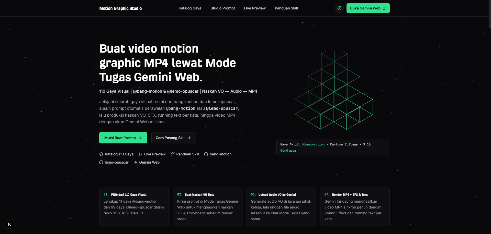
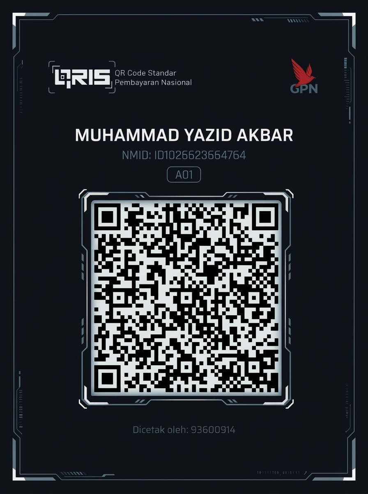

# Motion Graphic Studio

Aplikasi web pendamping 100% sisi klien (*browser-only*) untuk menjelajahi **110 gaya visual motion graphic** resmi dari `@bang-motion` dan `@lemo-opuscar`, menyusun prompt terstruktur untuk **Mode Tugas Gemini Web**, serta menguji pratinjau HTML secara langsung sebelum merender video **MP4** lengkap dengan Voice Over (VO), Sound Effect (SFX), dan running text per kata.



## Fitur Utama

- **Katalog 110 Gaya Visual (`#katalog`)**
  - Menghimpun **11 gaya `@bang-motion`** (6 Explainer + 5 Opener & Promo) dari [`bangtutorial/bang-motion`](https://github.com/bangtutorial/bang-motion) dan **99 gaya `@lemo-opuscar`** (15 kategori) dari [`lemomo-ai/lemo-opuscar`](https://github.com/lemomo-ai/lemo-opuscar).
  - Dilengkapi **Station Matrix** (17 stasiun bergaya *contribution graph*), filter repositori (`Semua`, `bang-motion`, `lemo-opuscar`), pencarian teks, filter kategori, palet warna referensi, dan modal detail gaya.
- **Studio Prompt Mode Tugas Gemini Web (`#studio`)**
  - Menyediakan 4 preset brief cepat, kartu pratinjau gaya visual terpilih yang membuka modal **Katalog 110 Gaya Visual** (dengan filter repositori, pencarian, kategori stasiun, dan pratinjau detail gaya), pilihan rasio aspek (`9:16` 1080×1920, `16:9` 1920×1080, `1:1` 1080×1080), dan durasi (`15s`, `30s`, `45s`, `60s` dengan estimasi 4–10 adegan).
  - Mendukung **alur 2 tahap berbasis Voice Over** (bahasa `id`/`en`, gaya narasi `santai`/`formal`/`storytelling`/`enerjik`, target TTS `ElevenLabs V4` dengan 40 Audio Tags resmi dari `docs/eleven-labs/tags-eleven-labs-v4.json` & panduan **Stability 60%**, `CapCut TTS / Voice`, atau `Umum / Dubbing Manual`, timecode, catatan intonasi, blok teks siap tempel ke TTS, serta Prompt Tahap 2 untuk sinkronisasi audio VO dengan SFX dan running text per kata).
  - Menyertakan opsi **Aturan Anti-Slide**, penyisipan detail gaya inline otomatis, persistensi otomatis seluruh konfigurasi aktif Studio Prompt di `localStorage` browser (`motion_graphic_studio_config_v1`) agar tetap terjaga saat halaman di-refresh, serta penyimpanan **Draft Tersimpan** (maksimal 12 draft, tanpa login atau database).
- **Live Stage Preview HTML (`#preview`)**
  - Editor kode HTML dan pratinjau `iframe` ter-sandbox (`sandbox="allow-scripts"`) untuk menguji output `index.html` (misalnya dari `@bang-motion`) dalam rasio `9:16`, `16:9`, atau `1:1`, lengkap dengan demo bawaan, tombol putar ulang, dan unduh `.html`.
- **Panduan Instalasi Skill (`#panduan`)**
  - **Gemini Web (Mode Tugas):** panduan 4 langkah mengunduh ZIP kedua repositori, mengaktifkan Mode Tugas, mengunggah ZIP dengan prompt `"Tolong install kedua skill ini"`, dan memeriksa menu **Keahlian → Keterampilan** beserta tangkapan layar referensi.
  - **Gemini CLI / Lokal:** perintah `npx skills add` untuk `bang-motion` dan `git clone` untuk `lemo-opuscar`.

## Alur Kerja 4 Langkah

1. **Pilih dari 110 Gaya Visual** — Pilih gaya dari `@bang-motion` atau `@lemo-opuscar` dalam rasio `9:16`, `16:9`, atau `1:1`.
2. **Buat Naskah VO Dulu** — Kirim prompt Tahap 1 di Mode Tugas Gemini Web untuk menghasilkan naskah VO dan storyboard sebelum render video.
3. **Upload Audio VO ke Gemini** — Generate audio VO di layanan TTS pihak ketiga (atau dubbing manual), lalu unggah file audio tersebut ke chat Mode Tugas yang sama.
4. **Render MP4 + SFX & Teks** — Kirim prompt Tahap 2 agar Gemini menghasilkan video MP4 yang sinkron dengan Sound Effect dan running text per kata.

## Menjalankan Secara Lokal

**Prasyarat:** Node.js dan npm.

Aplikasi ini berjalan sepenuhnya di sisi klien sebagai pendamping akun Gemini Web pengguna, sehingga **tidak memerlukan `GEMINI_API_KEY` maupun database**.

1. Clone repositori dan masuk ke direktori proyek:
   ```bash
   git clone https://github.com/Yazz803/Make-Your-Own-Motion-Graphic-Video.git
   cd Make-Your-Own-Motion-Graphic-Video
   ```
2. Install dependensi:
   ```bash
   npm install
   ```
3. *(Opsional)* Salin `.env.example` ke `.env.local` jika ingin mengatur `APP_URL` untuk `metadataBase` (default: `http://localhost:3000`):
   ```bash
   cp .env.example .env.local
   ```
4. Jalankan server pengembangan:
   ```bash
   npm run dev
   ```
5. Buka `http://localhost:3000` di browser.

## Perintah Tersedia

| Perintah | Deskripsi |
| --- | --- |
| `npm run dev` | Menjalankan server pengembangan Next.js |
| `npm run build` | Membuat build produksi Next.js (`output: 'standalone'`) |
| `npm run start` | Menjalankan hasil build produksi |
| `npm run lint` | Menjalankan pemeriksaan ESLint (`eslint .`) |
| `npm run typecheck` | Menjalankan pemeriksaan tipe TypeScript (`tsc --noEmit`) |
| `npm test` | Menjalankan unit test dan test kepatuhan arsitektur (`tests/*.test.mts`) |
| `npm run clean` | Membersihkan artefak build Next.js |

## Struktur Proyek

```text
├── docs/changelog/        # Catatan rilis per versi (PATCH-V0.1.1.md, PATCH-V0.2.0.md)
├── public/assets/         # Aset statis (screenshot panduan Gemini Web & desktop-hero.png)
├── src/
│   ├── app/               # Entry point Next.js App Router, font lokal, dan styling global
│   ├── components/        # Komponen layout (Navbar, Footer, StarfieldCanvas) & UI (Modal)
│   ├── features/          # Modul fitur: workspace, catalog, prompt-studio, stage-preview, skill-guide
│   ├── hooks/             # Custom React hooks
│   ├── lib/               # Prompt engine, konstanta 110 gaya visual, demo HTML, dan utilitas
│   └── types/             # Kontrak tipe TypeScript
└── tests/                 # Suite pengujian arsitektur, integritas katalog, dan prompt engine
```

## Teknologi

- **Framework:** Next.js 16 (App Router) & React 19
- **Bahasa & Styling:** TypeScript & Tailwind CSS v4
- **Animasi & Ikon:** GSAP (`@gsap/react`), Motion, dan `react-icons`

## Sumber & Lisensi

- Skill & katalog gaya visual bersumber dari [`bangtutorial/bang-motion`](https://github.com/bangtutorial/bang-motion) dan [`lemomo-ai/lemo-opuscar`](https://github.com/lemomo-ai/lemo-opuscar) untuk dijalankan di [Gemini Web](https://gemini.google.com/app).
- Dokumentasi produk dan sistem desain tersedia di [`PRODUCT.md`](PRODUCT.md), [`DESIGN.md`](DESIGN.md), dan [`docs/changelog/PATCH-V0.6.1.md`](docs/changelog/PATCH-V0.6.1.md).
- Dirilis di bawah [MIT License](LICENSE) — Copyright (c) 2026 Muhammad Yazid Akbar.

## Support Developer

Motion Graphic Studio dikembangkan dan dirawat secara terbuka oleh **Muhammad Yazid Akbar**. Jika proyek ini membantu alur produksi video motion graphic kamu, dukungan dapat diberikan melalui QRIS atau dengan terhubung lewat kanal berikut:



- **Repositori Proyek:** [github.com/Yazz803/Make-Your-Own-Motion-Graphic-Video](https://github.com/Yazz803/Make-Your-Own-Motion-Graphic-Video)
- **Instagram:** [instagram.com/_akbyzd](https://instagram.com/_akbyzd)
- **LinkedIn:** [linkedin.com/in/yazidakbar](https://linkedin.com/in/yazidakbar)
- **GitHub:** [github.com/Yazz803](https://github.com/Yazz803)
- **WhatsApp:** [wa.me/6281290215655](https://wa.me/6281290215655)
- **Threads:** [threads.com/@_akbyzd](https://threads.com/@_akbyzd)
- **Facebook:** [facebook.com/Lolsecz501](https://facebook.com/Lolsecz501)
